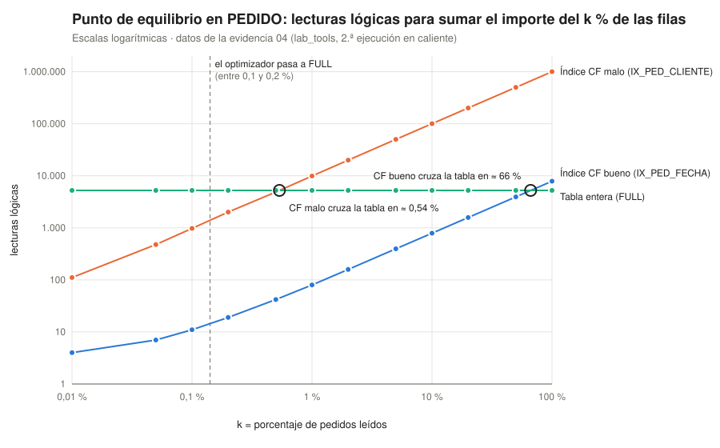

# Lab 5 · Respuestas

Cada respuesta cita la evidencia (archivo y valor) de `docs/bitacora/lab5/evidencia/`. Las cifras son las de mi entorno; cuando no coinciden con las del enunciado, lo explico.

## Antes de empezar: en qué se diferencia mi entorno del enunciado

- La imagen de Oracle 26ai ya venía en **ARCHIVELOG**, pero **sin FRA**: archivaba en el destino por defecto `$ORACLE_HOME/dbs/arch` (19 archivados, unos 3 GB, que ya incluían las cargas de TiendaSur). Lo vi en el `CREATE CONTROLFILE` de `09-controlfiles-info` (`... NORESETLOGS FORCE LOGGING ARCHIVELOG`) y en `v$archive_dest`. En la Parte L el script detectó el modo y solo configuró la FRA, sin reiniciar.
- El redo online son **3 grupos de 200 MB**, no 2 de 20 MB. Eso cambia un par de salidas de la Parte K (lo explico allí).
- El texto que devuelve `DBMS_OUTPUT` sale sin acentos (`l??gicas`) porque el contenedor no tiene `NLS_LANG`. Ya pasaba en el Lab 4; no afecta a las cifras.
- La migración V004 y los scripts `01-perfil-tiendasur.sql`, `06-propuesta-companero.sql` y `06-quitar-propuesta.sql` no venían en el enunciado y los escribí yo siguiendo la descripción de la Parte B y de la Parte G.

## Puntos de control y retos por Parte

### Parte A · Buena práctica: Lee el paso 6

> En la copia del Lab 3 aparecían cinco datafiles fuera del volumen; ahora, ninguno. Anótalo en tus respuestas.

Respuesta:

En mi caso salió "ninguno" en las dos copias: tanto en `00-backup-lab3` (Lab 4) como en `00-backup-lab4` (Lab 5) el paso 6 dice `ninguno: el volumen contiene toda la base de datos`. En mi imagen `$ORACLE_HOME/dbs` ya estaba enlazado con el volumen (lo anoté en el Lab 4), así que nunca tuve archivos fuera. Lo que sí confirma la copia del Lab 4 es que la reubicación de datafiles de aquel laboratorio no dejó nada suelto: la copia ocupa 670 MB comprimida y no necesitó ningún `extra_N.tar.gz`.

### Parte B · Reto: Comprueba el bfr de pedido con tus propias manos

Respuesta (evidencia `01-reto-bfr`):

Hay 5219 bloques con filas; el que menos tiene guarda 140 filas, el que más 200, y la media es 191,6. El diccionario dice `NUM_ROWS / BLOCKS = 1 000 000 / 5319 = 188`. No coinciden por dos motivos: `BLOCKS` cuenta los 5319 bloques del segmento por debajo de la marca de agua, incluidos los de cabecera y los que no llegaron a llenarse, mientras que mi recuento solo ve los 5219 que tienen filas; y no todas las filas miden lo mismo (el importe y el código postal ocupan más o menos bytes según el valor), así que en un bloque caben 191 o 192 y en otro 196 o 197. El bloque de 140 es el último que se llenó en la carga.

### Parte C · Reto: Calcula antes de medir

Respuesta (evidencias `02-reto-ux-cli-email` y `02-reto-grafico-*`):

1. A mano, con 30 bytes por entrada: caben `7996 / 30 = 266` entradas por hoja; con el 90 % de llenado salen `100 000 / 266 / 0,9 ≈ 418` hojas, y con fo = 543 una sola raíz basta: **altura 2**.
2. Medido: **altura 3**, 501 hojas y 3 bloques de rama. Mi cálculo falló porque las entradas reales miden 35,9 bytes (no 30) y las de rama 18,2 bytes, así que el fo máximo de este índice es 441, no 543. Con 501 hojas ya no caben todas debajo de una sola raíz y hace falta un nivel intermedio.
3. Los dos índices tienen 100 000 entradas, pero PK_CLIENTE ocupa 187 hojas al 99,6 % y UX_CLI_EMAIL 501 hojas al 89,6 %. La diferencia está en el orden de llegada de las claves: PK_CLIENTE se fue llenando durante la carga con claves crecientes (1, 2, 3…), así que Oracle hacía divisiones 90/10 y dejaba cada hoja llena; UX_CLI_EMAIL se creó después de la carga, ordenando las claves de golpe y dejando el PCTFREE 10 en cada hoja. Además, un email ocupa más que un número, y por eso necesita casi el triple de hojas.

### Parte D · Reto: El índice cubriente que sí pedirías

Respuesta (evidencia `03-reto-q9`):

No lo haría cubriente: Q9 ya cuesta **4 lecturas** con IX_PED_FECHA y meter todas las columnas en el índice sería duplicar casi entera una tabla de **42 MB** (el índice actual ocupa 22 MB) para ahorrar como mucho una lectura. Las 20 filas más recientes caen en el mismo bloque porque fecha y orden físico van juntos.

### Parte E · Reto: Dibuja tu curva

Respuesta (evidencia `04-agrupamiento-equilibrio`, gráfico generado con `scripts/lab5/04-curva-equilibrio.py`):



El índice con CF malo cruza la línea de la tabla (5231 lecturas) hacia el 0,54 %, el índice con CF bueno no la cruza hasta cerca del 66 %, y el optimizador se pasa al recorrido completo entre el 0,1 % y el 0,2 %. No coinciden porque miden cosas distintas: los dos cruces cuentan lecturas lógicas, donde una lectura aleatoria cuesta lo mismo que una secuencial; el optimizador, en cambio, supone que la lectura aleatoria del índice es más cara que la multibloque de la tabla, y por eso abandona el índice antes, justo donde dice la fórmula con c_sec/c_aleat = 1/5 (0,11 %).

### Parte F · Reto: Revisión de código como en un equipo real

Respuesta (evidencia `05-reto-revision`):

Comentario que dejaría en el PR:

> **issue (blocking):** la condición `SUBSTR(telefono, 1, 3) = '600' OR UPPER(apellidos) = 'GIL'` rompe dos reglas de sargabilidad: aplica una función a cada columna indexada (regla 1) y, como es un OR, basta con que una rama no pueda usar índice para leer la tabla entera (regla 5). Medido: 1449 lecturas, recorrido completo.
> Propuesta: `telefono LIKE '600%' OR apellidos = 'Gil'`. El prefijo de un teléfono es un rango del índice y los apellidos ya se guardan con mayúscula inicial, así que no hace falta `UPPER`. Medido: 746 lecturas con BITMAP OR sobre IX_CLI_TELEFONO e IX_CLI_APELLIDOS, mismas 1007 filas.
> **question:** ¿seguro que buscas a alguien que se apellide solo "Gil"? En la tabla los apellidos son "Primero Segundo" y `UPPER(apellidos) = 'GIL'` devuelve 0 clientes; si lo que quieres es el segundo apellido Gil (8397 clientes), eso es un comodín a la izquierda y no hay índice B-tree que lo arregle.

Los dos índices los creé solo para la prueba y los borré al final (el script termina con 7 índices en TIENDASUR).

### Parte G · Reto: Defiende tu propio índice

Respuesta (evidencia `06-reto-v006`):

Propongo `ix_cli_telefono` para Q5 (identificar a quien llama al centro de atención por email o teléfono), que V005 deja sin resolver:

1. **Necesidad:** Q5 hoy lee 1447 bloques (recorrido completo) porque la rama del teléfono no tiene índice.
2. **Viabilidad:** hay 99 959 teléfonos distintos en 100 000 clientes: cada valor es un 0,001 % de la tabla, muy por debajo del umbral.
3. **Escritura:** cada INSERT de cliente pasa de 10,1 a 12,1 bloques modificados (+2, la fórmula de la Parte G) y de 1400 a 1644 bytes de redo. En CLIENTE se dan de alta muchos menos registros que pedidos, así que el coste es asumible.
4. **Redundancia:** ningún índice de CLIENTE empieza por telefono.
5. **Ciclo de vida:** con el índice Q5 baja a 6 lecturas (BITMAP OR). Lo dejo como V006 en la rama `feat/10-v006-ix-cli-telefono`, sin fusionar, para que lo revise otra persona; en la base lo borré al terminar la prueba.

Conclusión: compensa (de 1447 a 6 lecturas a cambio de 2 bloques más por alta de cliente).

### Parte H · Reto: Diagnostica sin ver el script

Respuesta:

Este reto depende de un índice degradado que crea el profesor en un esquema de pruebas, así que no lo puedo hacer hasta que exista. El procedimiento que seguiré es el de la Parte H: `grafico-indice.sh` para ver el mapa (izquierda vacía y derecha llena = cola; huecos repartidos = fragmentación; todo entre 60 y 80 % = sano por divisiones 50/50), `ANALYZE INDEX ... VALIDATE STRUCTURE` para `DEL_LF_ROWS` y hojas reales, y una consulta que lea de más como síntoma. El diagnóstico irá como comentario en el Issue #10.

### Parte H · Punto de control: Antes de pasar a la durabilidad

Respuesta:

- Una búsqueda por PK cuesta **4 lecturas** porque PK_PEDIDO tiene altura 3 (raíz, rama y hoja) y luego hay que ir al bloque de la tabla (`02-anatomia-indice`, Buffers = 4; si solo pido `id_pedido`, 3).
- IX_PED_CLIENTE pierde frente a la tabla al 1 % porque su CF es 999 038: el 1 % son 10 000 filas en casi 10 000 bloques distintos (9917 lecturas) y la tabla entera son 5231 (`04-agrupamiento-equilibrio`).
- Q3 no usaba el índice porque comparaba un VARCHAR2 con un número y Oracle añadió `TO_NUMBER("CODIGO_POSTAL")` sobre la columna (`05-sargabilidad`).
- Cada índice cuesta unos 2 bloques por INSERT: 10,2 bloques con 4 índices, 20,2 con 9 (`06-indices`).
- La cola leía 288 bloques para un mensaje porque tenía que atravesar las hojas vacías de la izquierda (`07b-patron-cola`; en el enunciado eran 253).

### Parte I · Punto de control: Interpreta la salida

Respuesta (evidencia `08-scn-checkpoint`):

Tras el checkpoint todos los archivos abiertos pasan a 6 369 096, menos los dos de PDB$SEED (con_id 2), que se quedan en 2 098 101: la semilla está en solo lectura, nadie escribe en ella y el checkpoint no tiene nada que volcar ni motivo para actualizar su cabecera. En `v$instance_recovery` tenía `ACTUAL_REDO_BLKS = 399 608` y `ESTIMATED_MTTR = 44 s`: es el redo generado por la carga de TiendaSur (dos veces) y por todas las pruebas de índices de B a H, que aún no estaba cubierto por un checkpoint en el momento en que la vista se refrescó. Con una carga diez veces mayor habría mucho más redo pendiente y la recuperación tardaría más; lo acota `FAST_START_MTTR_TARGET`, que aquí está a 0 (sin objetivo, por eso `TARGET_MTTR = 0`).

### Parte I · Reto: El MTTR bajo carga

Respuesta (evidencia `08-reto-mttr`):

Antes del UPDATE de 20 000 filas, `ACTUAL_REDO_BLKS = 109`; después del COMMIT, 16 058 (unos 8 MB de redo pendiente). `ESTIMATED_MTTR` se quedó en 5 s porque Oracle no la recalcula al instante. La relación es directa: cuanto más redo queda por detrás del último checkpoint, más tiene que leer y aplicar SMON al arrancar, y más tarda la recuperación.

### Parte K · Diferencias de mi salida

Respuesta (evidencia `10-redo` y `10-reto-redo`):

Con 3 grupos, tras dos cambios de log el grupo 2 todavía no había vuelto a ser CURRENT y `redo02b.log` seguía INVALID; con un tercer cambio quedó válido (`10-reto-redo`). El paso 4c dio `ORA-01624: log 2 needed for crash recovery` en vez de ORA-01567: al tener 3 grupos, borrar uno no dejaba menos de dos, pero el grupo elegido estaba ACTIVE y Oracle lo protege porque aún hace falta para una recuperación de instancia.

### Parte K · Reto: Dimensiona el redo de TiendaSur

Respuesta (evidencia `10-reto-redo`):

En la hora de las 00h, cuando cargué TiendaSur e hice las Partes B a H, hubo 15 cambios de log y 2273 MB de redo archivado. Para que esa carga provocara como mucho 4 cambios, cada grupo debería tener `2273 / 4 ≈ 570 MB`; propondría **600 MB**. Comandos (sin ejecutar):

```sql
ALTER DATABASE ADD LOGFILE GROUP 4 ('/opt/oracle/oradata/FREE/redo04.log', '/opt/oracle/oradata/FREE/redo04b.log') SIZE 600M;
ALTER DATABASE ADD LOGFILE GROUP 5 ('/opt/oracle/oradata/FREE/redo05.log', '/opt/oracle/oradata/FREE/redo05b.log') SIZE 600M;
ALTER DATABASE ADD LOGFILE GROUP 6 ('/opt/oracle/oradata/FREE/redo06.log', '/opt/oracle/oradata/FREE/redo06b.log') SIZE 600M;
-- repetir hasta que los grupos 1, 2 y 3 estén INACTIVE (y archivados)
ALTER SYSTEM SWITCH LOGFILE;
ALTER SYSTEM CHECKPOINT;
SELECT group#, status, archived FROM v$log;
ALTER DATABASE DROP LOGFILE GROUP 1;
ALTER DATABASE DROP LOGFILE GROUP 2;
ALTER DATABASE DROP LOGFILE GROUP 3;
-- y después borrar redo0{1,2,3}.log y redo0{1,2,3}b.log del disco
```

### Parte L · Punto de control: Interpreta la salida

Respuesta (evidencia `11-activar-archivelog`):

En mi caso los procesos ARC0-ARC3 ya existían porque la base venía en ARCHIVELOG; lo que cambió es el destino, que pasó de `$ORACLE_HOME/dbs/arch` (nombres `arch1_21_1237845575.dbf`) a `USE_DB_RECOVERY_FILE_DEST`. Los archivados nuevos tienen nombres OMF (`o1_mf_1_23_ofzx66no_.arc`) y están en `/opt/oracle/oradata/fra/FREE/archivelog/2026_10_27/`, como comprobé con `find`.

### Parte L · Escenario de la FRA llena

Respuesta (evidencia `11-fra-llena`, dos ejecuciones):

La primera vez no saltó ningún error: la FRA estaba vacía y el archivado del UPDATE ocupó menos de los 2 MB, así que cupo. Repetí el script y en la segunda ejecución (con 1,8 MB ya usados) sí apareció todo: `ORA-16038: log 3 sequence# 27 cannot be archived`, `ORA-19809: limit exceeded for recovery files`, los avisos ORA-19815 al 91,58 % y al 100 %, y dos grupos con `ARC = NO`. Al devolver los 4 GB, ARCn archivó solo y la FRA quedó en 10,8 MB.

### Parte M · Punto de control: Interpreta la salida

Respuesta (evidencia `12-lectura-consistente`):

En el paso 1 el bloque del buffer cache ya dice EGRESADO, pero B ve ACTIVO porque Oracle le construye una copia del bloque tal como estaba antes del cambio usando el undo de A (1 bloque y 1 registro de undo en `v$transaction`). En el paso 4 B no puede bloquear la fila porque A tiene el bloqueo TX en modo 6 sobre ella (ORA-00054 y ORA-40097 con la transacción 5.1.758); leer no necesita bloqueo, escribir sí. El flashback del paso 6 funciona porque el undo de A sigue ahí aunque ya se hiciera COMMIT: Oracle intenta conservarlo `UNDO_RETENTION = 900` segundos.

### Parte M · Reto: El coste de un DELETE en tu FRA

Respuesta (evidencia `12-reto-fra`):

La FRA pasó de 11 056 KB a 30 382 KB: creció 19 326 KB. Sumando la columna de redo de las tres operaciones y sus ROLLBACK sale 18 679 KB (4896 + 356 + 1309 + 790 + 6627 + 4701). La diferencia, unos 650 KB, es el redo de todo lo demás que hace la instancia a la vez (procesos de fondo, las consultas a `v$mystat` y `v$transaction`) y las cabeceras de los archivados.

### Parte N · Punto de control: Interpreta la salida

Respuesta (evidencia `13-lgwr-dbwn`):

Justo después del COMMIT, DBWn había escrito **0 bloques** y la tabla tenía **231 bloques sucios**: ninguno de los cambios estaba en el datafile. La garantía está en los 1779 KB de redo que LGWR escribió (3 escrituras) antes de devolver "Commit complete". Con el checkpoint DBWn escribió 347 bloques y los sucios bajaron a 0: más que los 231 de la tabla porque el UPDATE también ensucia bloques de undo y la cifra es de toda la instancia. El redo es grande para un UPDATE que no cambia nada porque Oracle no compara valores: registra el cambio y su undo de las 20 000 filas igualmente (en mi ejecución 1,8 MB; en el enunciado 7,5 MB, porque allí se juntó con limpieza diferida de partes anteriores).

### Parte O · Punto de control: Simulacro B

Respuesta (evidencia `14b-perdida-controlfile`):

La instancia arranca (NOMOUNT: SPFILE, SGA y procesos) y se para al **montar**, que es justo cuando lee los control files; el alert log dice `ORA-00202: control file: '.../control03.ctl'` y `ORA-27037: unable to obtain file status`. Basta copiar `control01.ctl` porque las tres copias son idénticas y, con la base parada, ninguna está cambiando. Con la base abierta no se podría: el control file se actualiza continuamente y la copia saldría inconsistente (además, si una copia falla con la base abierta, la instancia se cae). Si se perdieran las tres, habría que restaurarlo con RMAN (`RESTORE CONTROLFILE FROM AUTOBACKUP`, ahora hay autobackup en la FRA desde el simulacro D) y abrir con RESETLOGS, o usar el `CREATE CONTROLFILE` de `controlfile_lab5.trc` de la Parte J.

### Parte O · Punto de control: Simulacro D

Respuesta (evidencia `14d-perdida-datafile`):

`ORA-01116` dice qué número de archivo no se puede abrir (16), `ORA-01110` da la ruta (`academia01.dbf`) y `ORA-27041` con `Linux Error: 2: No such file or directory` es la causa en el sistema operativo. Me tocó el **camino B**: cuando el script miró `v$pdbs`, FREEPDB1 ya estaba MOUNTED porque un proceso de fondo detectó el fallo de medio y Oracle cerró la PDB (ORA-63999 en el alert log). La fila 104 salió EGRESADO aunque la copia RMAN era anterior al cambio porque RECOVER aplicó encima el redo posterior a la copia. El RTO fue de 12 s desde que empecé a reparar y 13 s desde el fallo, frente a 111 s del simulacro C; y el RPO fue 0 frente a "todo lo posterior a la copia" del C.

### Parte O · Reto: Escribe el runbook del simulacro D

Respuesta: está en `docs/runbooks/perdida-datafile.md`.

### Parte P · Punto de control: Clasifica cada error del bloque 5

Respuesta (evidencia `spool/..._15-healthcheck.spool.log`):

| Error | Clasificación | Qué lo explica |
|---|---|---|
| ORA-63999 data file suffered media failure | Efecto del laboratorio | Simulacro D: borré `academia01.dbf` |
| ORA-01110 data file 16 (academia01.dbf) | Efecto del laboratorio | Simulacro D |
| ORA-01113 file 26 needs media recovery (tiendasur01.dbf) | Efecto del laboratorio | Al reabrir FREEPDB1 tras el ORA-63999 Oracle revisó las cabeceras; la PDB terminó abierta |
| ORA-00202 control03.ctl / ORA-205 en MOUNT | Efecto del laboratorio | Simulacro B |
| ORA-00800 Set Priority Failed (LGWR, VKTM) | Ruido conocido | Ya clasificado en el Lab 4: el contenedor no deja cambiar la prioridad de esos procesos |
| ORA-16038, ORA-19809, ORA-19815 (no salen en las 10 últimas filas) | Efecto del laboratorio | Escenario de la FRA llena, Parte L |

Ninguno es un incidente real. Los 25 cambios de log de la hora 00h sí serían preocupantes en producción: aquí los provocaron la carga de TiendaSur y las Partes B a H, pero en una base real indicarían redo pequeño para la carga o un proceso masivo que hay que investigar. Si el bloque 7 saliera vacío en producción, hoy mismo lanzaría una copia completa con RMAN (`BACKUP DATABASE PLUS ARCHIVELOG`), activaría `CONTROLFILE AUTOBACKUP` y programaría la copia diaria.

### Parte P · Reto: Un umbral que dispare una alerta

Respuesta (script `scripts/lab5/15-alerta.sql`, evidencia `15-reto-alerta`):

```sql
SELECT 'ALERTA: ' || LISTAGG(motivo, ' | ') WITHIN GROUP (ORDER BY motivo) AS alerta
  FROM (SELECT 'FRA al ' || ROUND(100 * space_used / space_limit, 1) || ' % (umbral 85 %)' AS motivo
          FROM v$recovery_file_dest WHERE space_limit > 0 AND space_used / space_limit > 0.85
        UNION ALL
        SELECT 'ninguna copia RMAN completada en 24 h' FROM dual
         WHERE NOT EXISTS (SELECT 1 FROM v$rman_backup_job_details WHERE status = 'COMPLETED' AND end_time > SYSDATE - 1))
HAVING COUNT(*) > 0;
```

Con la base como está no devuelve nada. Para comprobar que dispara bajé el umbral al 0,1 % en una copia temporal y devolvió `ALERTA: FRA al 1,8 % (umbral de PRUEBA 0,1 %)`.

## Game day: RTO y RPO de los cuatro simulacros

| Simulacro | Fallo | RTO medido | RPO real | Qué me sorprendió | Qué cambiaría |
|---|---|---|---|---|---|
| A | SHUTDOWN ABORT (corte de luz) | Lo que tarda un STARTUP: la sonda la vio abierta en el primer intento (< 10 s) | 0 | Solo hubo que rehacer 13 KB de redo y 13 bloques, porque poco antes había hecho un checkpoint | Nada en el procedimiento; sí fijar `FAST_START_MTTR_TARGET` para que el tiempo no dependa de la suerte |
| B | Se pierde `control03.ctl` | Un par de minutos, casi todo es parar y arrancar | 0 | Que el alert log diga exactamente qué archivo falta | Poner cada copia en un disco distinto: aquí están las tres en el mismo volumen |
| C | `DROP TABLE ... PURGE` | 111 s restaurando la copia completa de 1,6 GB | Todo lo hecho desde la copia (1 s aquí porque la copia se hizo justo antes; en la vida real, horas) | Restauré toda la base para recuperar una tabla de 60 000 filas | Usar RMAN `RECOVER TABLE` ahora que la base está en ARCHIVELOG con FRA |
| D | Se borra `academia01.dbf` | 13 s desde el fallo | 0 | Oracle cerró FREEPDB1 entera (ORA-63999) antes de que yo hiciera nada | Comprobar siempre `v$pdbs` antes de reparar, como dice el runbook |

La lección: en el C el tiempo depende del tamaño de la base, y en el D del tamaño del daño. Y el RPO pasa de "lo que haya pasado desde la última copia" a cero gracias al redo archivado.

## Retrospectiva sin culpables: la FRA llena

```
## Incidente: el archivado se detiene por FRA llena (entorno de laboratorio, provocado en la Parte L)
- Impacto: dos grupos de redo sin archivar (ARC = NO); si se hubiera seguido generando redo, las sesiones
  se habrían quedado esperando en "log file switch (archiving needed)". Ninguna pérdida de datos.
- Detección: ORA-16038 y ORA-19809 en la sesión; antes, ORA-19815 en el alert log al 91,58 % y al 100 %.
- Causa raíz: db_recovery_file_dest_size reducido a 2 MB, por debajo del redo que había que archivar.
  Hallazgo previo relacionado: la base archivaba en $ORACLE_HOME/dbs/arch sin límite ni vigilancia
  (19 archivados, unos 3 GB) hasta que configuré la FRA.
- Mitigación: devolver el tamaño a 4 GB (SCOPE = MEMORY); ARCn reintentó solo. La verificación 16
  comprueba que en el SPFILE siguen los 4 GB.
- Qué cambia: la alerta de 15-alerta.sql avisa por encima del 85 %; antes de repetir cargas grandes, mirar
  v$recovery_area_usage. Pendiente: limpiar con RMAN los archivados antiguos de dbs/arch.
- Lección: el primer intento no falló porque el archivado cupo por poco; el aviso ORA-19815 llegó antes que
  el bloqueo, y nadie lo habría mirado sin un runbook.
```

## Preguntas de comprobación

### Punto de partida y banco de medida (A, B)

**1. Compara el paso 6 de tu copia lab4-final con el de la copia lab3-final. ¿Qué demuestra la diferencia?**

Respuesta:

En mi caso no hay diferencia: las dos dicen `ninguno: el volumen contiene toda la base de datos` (`lab4/evidencia/script/..._00-backup-lab3` y `lab5/evidencia/script/..._00-backup-lab4`). Mi imagen ya tenía `$ORACLE_HOME/dbs` dentro del volumen, así que el Lab 3 no me dejó archivos fuera. Lo que demuestra es que la copia de lab4-final es completa por sí sola: si mañana restauro el volumen, no falta ningún archivo de la base.

**2. Calcula el factor de bloqueo (bfr) de CLIENTE y de PEDIDO con sus estadísticas. ¿Por qué PEDIDO cabe casi el triple de filas por bloque?**

Respuesta:

Con `01-perfil-tiendasur`: CLIENTE, `100 000 / 1478 = 68` filas por bloque; PEDIDO, `1 000 000 / 5319 = 188`. PEDIDO cabe casi el triple porque cada fila mide 32 bytes de media frente a los 98 de CLIENTE (que lleva email, nombre, apellidos, teléfono y ciudad). El bfr no es una propiedad del diseño, depende del tamaño de fila.

**3. ¿Por qué el banco de medida ejecuta cada sentencia dos veces y mide solo la segunda?**

Respuesta:

Porque la primera ejecución arrastra trabajo que solo se hace una vez: el análisis (parse), cargar bloques en la caché o la limpieza diferida de bloques tras la carga. En la Parte C se ve: la primera ejecución de la búsqueda por PK puede leer 5 bloques y la segunda lee 4. Midiendo la segunda comparo siempre en caliente y las cifras son repetibles.

### Anatomía y tipos de índice (C, D)

**4. Con tu evidencia 02: altura, número de hojas y factor de ramificación (fan-out) real de IX_PED_CLIENTE. ¿Qué altura tendría con mil millones de filas?**

Respuesta:

Altura 3, 2216 hojas, 6 bloques de rama y fo real `(2216 + 6 − 1) / 6 = 370` (máximo 543). Con mil millones de filas harían falta unas 2 208 969 hojas y la altura sería **4**, o sea 5 lecturas para encontrar una fila (`02-anatomia-indice`, sección 2).

**5. En el volcado de la hoja de PK_CLIENTE, localiza una entrada y descompón el ROWID que guarda en bloque y fila. ¿Por qué no aparece el número de archivo?**

Respuesta:

La primera entrada es `row#0[1200] ... data:(6): 00 00 03 1b 00 00` con `col 0: c1 02`. Los 4 primeros bytes son el bloque (0x31B = 795) y los 2 últimos la ranura (0). La clave `c1 02` es el número 1, y la comprobación del script lo confirma: el cliente 1 está en el bloque 795, ranura 0. No aparece el número de archivo porque TBS_TIENDASUR es un tablespace BIGFILE: tiene un único datafile y el índice no necesita guardarlo, así que el ROWID del índice ocupa 6 bytes en lugar de 10.

**6. Elige tres pruebas de la Parte D y explica, con las lecturas lógicas medidas, por qué un tipo de índice gana al otro.**

Respuesta (evidencia `03-tipos-indice`):

- **Q7 compuesto y cubriente:** con IX_PED_CLIENTE lee 15 bloques y además ordena (SORT ORDER BY); con (id_cliente, fecha_pedido) baja a 7 porque el índice ya devuelve las filas ordenadas; con el cubriente baja a 3 porque ni siquiera va a la tabla.
- **Q14 bitmap:** sin bitmaps son 4073 lecturas (recorrido completo); con los cuatro bitmaps combinados con BITMAP AND son 528. Además el bitmap de región ocupa 114 hojas frente a las 1954 del B-tree equivalente.
- **Q15 clúster hash:** montículo + PK lee 4, IOT 3 y el clúster hash 1, porque la clave se convierte directamente en la dirección del bloque. Pero la limpieza por rango en el clúster hash lee 2770 bloques: no sirve para rangos.

### Agrupamiento, equilibrio y sargabilidad (E, F)

**7. ¿Por qué IX_PED_FECHA tiene un clustering factor cercano al número de bloques e IX_PED_CLIENTE cercano al de filas? ¿Lo arreglaría un REBUILD?**

Respuesta:

Los pedidos se cargaron ordenados por id y fecha, así que recorrer IX_PED_FECHA en orden es recorrer la tabla bloque a bloque: CF = 5219, igual que los bloques con filas. El cliente, en cambio, se repartió al azar, y cada entrada de IX_PED_CLIENTE salta a otro bloque: CF = 999 038 de 1 000 000 filas. El cálculo a mano con LAG da exactamente los mismos números (`04-agrupamiento-equilibrio`, sección 2). Un REBUILD no lo arreglaría: el CF depende de cómo están ordenadas las filas en la tabla, no del índice. Solo cambiaría reordenando la tabla, y entonces empeoraría el de fecha.

**8. Según tu curva de la Parte E, ¿a partir de qué porcentaje deja de compensar cada índice? Compáralo con la fórmula de la Unidad 3.**

Respuesta:

El índice con CF malo lee más que la tabla a partir del 1 % (9917 frente a 5231); interpolando, el cruce está hacia el 0,54 %. Coincide con la fórmula en lecturas lógicas: `1 / bfr = 1 / 188 = 0,53 %`. El índice con CF bueno aguanta hasta el 50 % (3938 lecturas) y solo pierde al 100 % (7874), porque lee unas k/bfr hojas y bloques seguidos. El optimizador cambia antes, entre el 0,1 y el 0,2 %, que es lo que da la fórmula en disco con c_sec/c_aleat = 1/5: 0,11 %.

**9. Explica por qué Q4b ('Gonz%') usa el índice y aun así lee más bloques que un recorrido completo.**

Respuesta (evidencias `05-sargabilidad` y `05-reto-revision`):

En mi base el optimizador ni siquiera lo usó: eligió recorrido completo (1450 lecturas) para las 2012 filas. Forzando el índice con un hint, la consulta es sargable y baja por el índice, pero lee **1931** bloques, más que la tabla. El motivo: 'Gonz%' es el 2 % de los clientes y IX_CLI_APELLIDOS tiene un CF de 84 386 sobre 1478 bloques (los apellidos no siguen el orden físico), así que cada fila es casi un bloque distinto. El 2 % está muy por encima del punto de equilibrio de un índice con CF malo (1/68 ≈ 1,5 % en CLIENTE). Sargable significa que puede usar el índice, no que le convenga.

### Coste de escritura y mantenimiento (G, H)

**10. Con tu evidencia 06: bloques modificados por INSERT con 4, 9 y 5 índices. ¿Qué índices de la propuesta del compañero rechazaste y con qué dato?**

Respuesta:

10,2 bloques por INSERT con los 4 índices de hoy, 20,2 con los 9 de la propuesta y 12,1 con los 5 de V005 (`06-indices`). Rechacé IX_PED_CANAL (no lo usó ninguna consulta habitual y cada canal es el 33 % de la tabla), IX_PED_ESTADO (cada estado es un 25 % de media: no viable; para 'P' es mejor el índice parcial, que tiene 54 hojas en lugar de 1812), IX_PED_FEC_CLI (sin uso en la carga habitual y, además, deja IX_PED_FECHA como prefijo redundante: uno de los dos sobra, y el que usan Q2, Q8 y Q9 es el corto) e IX_PED_CLI_FEC (lo sustituye el cubriente, que empieza igual y además evita ir a la tabla). Del compañero me quedé solo con la idea de IX_PED_CP, que sí usa Q3 una vez reescrita (0,01 % por código postal, 115 lecturas).

**11. Distingue, con tus gráficos de la Parte H, un índice con divisiones 50/50, uno con divisiones 90/10 y uno con patrón cola.**

Respuesta (evidencias `07a-grafico-*` y `07b-grafico-IX_COLA-antes`):

- **50/50 (IX_AZAR):** 595 divisiones y ninguna 90/10; histograma repartido entre el 40 y el 99 % y ocupación media del 75 %; el mapa mezcla `=` y `-` por todo el ancho.
- **90/10 (IX_CRECIENTE):** 398 divisiones, todas 90/10; 398 de 399 hojas entre el 90 y el 99 %; mapa uniforme de `#`.
- **Cola (IX_COLA):** 286 hojas casi vacías y 199 llenas; el mapa `[                                   .############################]` está vacío a la izquierda y lleno a la derecha, con 90 277 entradas borradas.

**12. ¿Qué remedio elegirías para el patrón cola en producción, en horario de servicio, y por qué?**

Respuesta:

`ALTER INDEX ... COALESCE`. Es en línea, no bloquea, y resolvió el síntoma por completo: de 487 a 201 hojas y de 288 a 2 lecturas para el siguiente mensaje (`07c-remedios`). Si además quisiera devolver espacio usaría SHRINK SPACE (de 4 a 1,69 MB). REBUILD ONLINE no aporta nada más aquí y gasta espacio doble y mucho redo. A largo plazo, la solución de verdad sería particionar por fecha y vaciar particiones enteras.

### SCN, control files, redo y FRA (I a L)

**13. Con tu evidencia 08: ¿qué valores compara Oracle al abrir para decidir si hace falta recuperación?**

Respuesta:

El SCN de checkpoint que guarda el control file para cada datafile (`v$datafile.checkpoint_change#`) con el que tiene escrito la cabecera del propio archivo (`v$datafile_header.checkpoint_change#`). En mi evidencia, tras el checkpoint, los dos valen 6 369 096 en system01, sysaux01 y academia01: están sincronizados y no harían falta recuperar. Si no coinciden (o el cierre no fue limpio), Oracle aplica redo desde ese SCN.

**14. ¿Qué protege la multiplexación del control file en el mismo volumen y qué no? ¿Cómo se haría en producción?**

Respuesta:

Protege de perder o dañar un archivo concreto: en el simulacro B borré `control03.ctl` y lo arreglé copiando `control01.ctl` sin perder nada. No protege de perder el volumen o el disco, porque las tres copias están en `/opt/oracle/oradata/FREE` y se irían juntas, ni de una corrupción lógica que Oracle escriba en las tres a la vez. En producción pondría cada copia en un disco y, si se puede, en una controladora distinta (o en ASM con redundancia), y activaría `CONFIGURE CONTROLFILE AUTOBACKUP ON` en RMAN.

**15. Explica los estados CURRENT, ACTIVE e INACTIVE con tu evidencia 10 y por qué Oracle rechaza los tres borrados del paso 4.**

Respuesta:

CURRENT es el grupo en el que escribe LGWR (después del segundo cambio, el 1 con secuencia 22); ACTIVE es un grupo que ya no es el actual pero cuyos cambios aún no están todos en los datafiles (el 2 y el 3 tras los cambios: se necesitarían para recuperar la instancia); INACTIVE es un grupo cuyo contenido ya está en los datafiles y, como estamos en ARCHIVELOG, ya archivado (el 1 con secuencia 19 al principio). Oracle rechaza borrar el grupo CURRENT (ORA-01623) y un miembro del CURRENT (ORA-01609) porque es donde está escribiendo. El tercero, en mi caso, dio ORA-01624 porque el grupo elegido estaba ACTIVE y se necesita para una recuperación; con 2 grupos habría saltado ORA-01567 (no se puede dejar menos de dos).

**16. Describe la cadena de causas del escenario de la FRA llena, desde ORA-19815 hasta que la base deja de aceptar cambios.**

Respuesta:

La FRA se acerca a su límite y Oracle avisa en el alert log con ORA-19815 (en mi evidencia, al 91,58 % y al 100 %). Cuando ARCn intenta archivar el siguiente grupo no tiene sitio: ORA-19809 y ORA-16038, y el grupo queda con `ARC = NO`. En ARCHIVELOG un grupo no se puede reutilizar hasta que está archivado, así que en cuanto LGWR da la vuelta y necesita ese grupo se queda esperando ("log file switch (archiving needed)"). A partir de ahí cualquier sesión que genere redo se para y las conexiones nuevas reciben ORA-00257. En mi escenario lo corté antes de llegar ahí devolviendo los 4 GB.

### Undo, WAL y simulacros (M a P)

**17. Explica, con los pasos 1 a 4 de tu evidencia 12, la frase "lectores no bloquean a escritores".**

Respuesta:

A cambió la fila 101 y no confirmó: tiene un TM modo 3 sobre la tabla y un TX modo 6 (paso 3). Aun así, B la leyó sin esperar y vio ACTIVO (paso 1), reconstruida con el undo de A (1 bloque de undo en el paso 2). Leer no pidió ningún bloqueo. Solo cuando B quiso escribir, con `FOR UPDATE WAIT 3`, chocó con A y recibió ORA-00054 (paso 4). Así que los lectores no bloquean ni son bloqueados; solo se bloquean dos escritores sobre la misma fila.

**18. ¿Por qué un DELETE genera más undo que un INSERT? ¿Por qué el ROLLBACK también genera redo?**

Respuesta (evidencia `12-undo-y-redo`):

Para deshacer un INSERT basta con saber qué ROWID borrar (141 bloques de undo para 10 000 filas); para deshacer un DELETE hay que guardar la fila entera y sus entradas de índice (427 bloques, el triple). El ROLLBACK genera redo porque deshacer es hacer cambios nuevos sobre los bloques, y todo cambio en un bloque se registra en el redo: deshacer el DELETE generó 4701 KB.

**19. Con tu evidencia 13: ¿dónde está la garantía de durabilidad justo después del COMMIT? ¿Y después del checkpoint?**

Respuesta:

Después del COMMIT, en el redo log online: LGWR escribió 1779 KB, mientras que DBWn había escrito 0 bloques y la tabla tenía 231 bloques sucios en memoria. Si la luz se hubiera ido en ese momento, el redo habría permitido rehacer el cambio. Después del checkpoint la garantía está además en los propios datafiles: DBWn escribió 347 bloques y quedaron 0 sucios, así que ese redo ya no haría falta para recuperar la instancia (solo para recuperación de medios, y para eso está archivado).

**20. Simulacro A: explica roll forward y roll back con las filas 102 y 103 y las líneas del alert log.**

Respuesta (evidencia `14a-caida-instancia`):

Al arrancar, SMON empezó la recuperación (`Beginning crash recovery of 1 threads`) desde el último checkpoint (`logseq 31 block 4024, scn 6372971`). Primero el **roll forward**: leyó 13 KB de redo y rehízo 13 bloques que no habían llegado al disco, incluido el cambio de las dos filas y el undo de la transacción sin confirmar. Después el **roll back**: con ese undo deshizo lo que no estaba confirmado. Resultado: la 102 se quedó en EGRESADO porque había hecho COMMIT (durabilidad) y la 103 volvió a ACTIVO porque no (atomicidad). La base abrió en la secuencia 32 sin que yo hiciera nada.

**21. Simulacros C y D: tu RTO y tu RPO en cada uno. ¿Por qué son tan distintos?**

Respuesta:

C: RTO de 111 s y RPO de todo lo hecho desde la copia (en el laboratorio 1 s porque la copia se hizo justo antes). D: RTO de 13 s desde el fallo y RPO 0. En el C restauré la base entera (1,6 GB) por una tabla, así que el tiempo depende del tamaño de la base y pierdo todo lo posterior a la copia. En el D solo restauré un archivo desde la copia RMAN y luego RECOVER aplicó el redo archivado y el online, así que el tiempo depende del daño y no se pierde nada.

**22. Clasifica cada error ORA- del bloque 5 de tu runbook: incidente real, efecto del laboratorio o ruido conocido.**

Respuesta: lo respondo con la tabla de la Parte P (punto de control): todos los ORA- del bloque 5 son efectos del laboratorio (simulacros B y D, escenario de la FRA) salvo ORA-00800, que es ruido conocido del contenedor desde el Lab 4. Ninguno es un incidente real.

## Preguntas tipo examen de cada Parte

**B1.** Letra: **B**. E-Rows 25 000 frente a A-Rows 20 en una columna sesgada es el síntoma típico de que falta el histograma: sin él, el optimizador supone un reparto uniforme (en V004 lo evité con histograma en estado, Parte B).

**C1.** Letra: **C**. BLEVEL 2 es altura 3; más el bloque de tabla, 4 lecturas (lo mismo que medí en la búsqueda por PK de pedido, Parte C).

**C2.** Letra: **C**. Con fo 500, dos niveles de rama solo alcanzan 250 000 hojas; para 2 000 000 hacen falta tres niveles de rama más las hojas: altura 4.

**D1.** Letra: **B**. Baja cardinalidad, carga nocturna y filtros combinados: un bitmap por columna y BITMAP AND (Q14 bajó de 4073 a 528 lecturas, Parte D).

**D2.** Letras: **A y C**. El cubriente evita ir a la tabla (Q7 en 3 lecturas) y encarece las escrituras de sus columnas (UPDATE de estado pasa a 8,1 bloques con V005).

**E1.** Letra: **B**. Con CF casi igual a las filas, el 3 % está muy por encima del punto de equilibrio (1/125 = 0,8 %): recorrido completo. Reconstruir no cambia el CF (Parte E).

**F1.** Letra: **B**. Comparar el VARCHAR2 con un número hace que Oracle aplique TO_NUMBER a la columna (Q3 de la Parte F).

**F2.** Letras: **A y C**. Las dos dejan la columna desnuda y cubren el día completo; B solo encuentra la medianoche, D y E siguen aplicando algo a la columna.

**G1.** Letra: **B**. INVISIBLE: el optimizador lo ignora pero se sigue manteniendo y se vuelve atrás con VISIBLE (Parte G, pregunta 5).

**G2.** Letra: **B**. Unos 2 bloques por INSERT y por índice: 500 × 2 = 1000 bloques por segundo.

**H1.** Letra: **B**. COALESCE resuelve la cola en línea y barato (de 288 a 2 lecturas, Parte H).

**H2.** Letras: **A y C**. Reparte la hoja caliente pero no sirve para rangos (878 lecturas frente a 4 en el BETWEEN, Parte H).

**I1.** Letra: **B**. Compara el SCN de checkpoint del control file con el de la cabecera del datafile (Parte I).

**J1.** Letra: **B**. Si una copia falla con la base abierta, la instancia se detiene; se repone o se quita de CONTROL_FILES y se arranca.

**J2.** Letras: **A y C**. Nombres y rutas de datafiles y redo, y el SCN de checkpoint; lo vi en el CREATE CONTROLFILE de la Parte J.

**K1.** Letra: **C**. ACTIVE contiene cambios que aún podrían hacer falta para recuperar la instancia (ORA-01624 en mi paso 4c).

**L1.** Letra: **B**. Primero el tamaño y luego la ruta (ORA-19802 en el paso 2 de la Parte L).

**L2.** Letras: **A y C**. Más tamaño si hay disco o copiar y borrar con RMAN; nunca rm (en la Parte L lo resolví ampliando a 4 GB).

**M1.** Letra: **C**. Ve el valor confirmado reconstruido con el undo (paso 1 de la Parte M).

**M2.** Letra: **C**. DELETE: 427 bloques de undo frente a 141 del INSERT y 74 del UPDATE (Parte M).

**M3.** Letras: **B y D**. Más retención y espacio de undo, y RETENTION GUARANTEE si la consulta es crítica.

**N1.** Letra: **A**. El redo está en el redo log online; los datafiles no (0 bloques de DBWn tras el COMMIT, Parte N).

**N2.** Letras: **B y C**. En un checkpoint y cuando no hay buffers libres; nunca por un COMMIT.

**O1.** Letra: **B**. SMON rehace y deshace y la base abre sola (simulacro A).

**O2.** Letras: **B y D**. Copiar una copia sana o quitar la perdida de CONTROL_FILES (simulacro B).

**O3.** Letra: **B**. OFFLINE, RESTORE, RECOVER y ONLINE con la base abierta (simulacro D, camino A del runbook).

**O4.** Letra: **D**. RMAN RECOVER TABLE recupera solo esa tabla a un instante sin tocar el resto; FLASHBACK TABLE no sirve tras PURGE.

## Simulacro de examen 1Z0-182 (S1-S26)

| Pregunta | Letra | Justificación | Dónde lo comprobé |
|---|---|---|---|
| S1 | B | CF ≈ filas: casi un bloque distinto por fila | Parte E (IX_PED_CLIENTE, CF 999 038) |
| S2 | A y C | Índice funcional o aplicar la función al dato | Partes D (Q1 con índice funcional) y F (Q1 reescrita) |
| S3 | B | TO_NUMBER sobre la columna | Parte F, regla 3 |
| S4 | B | Bitmap en almacén de datos con baja cardinalidad | Parte D, Q14 |
| S5 | B | INDEX SKIP SCAN | Parte D, Q6 solo ciudad |
| S6 | B | INVISIBLE y observar | Parte G, pregunta 5 |
| S7 | A y C | COALESCE y SHRINK SPACE, los dos en línea | Parte H (07c-remedios) |
| S8 | B | Reparte inserciones, pero no sirve para rangos | Parte H (878 frente a 4 lecturas) |
| S9 | C | Un UPDATE de columna no indexada solo toca la tabla | Parte G (UPDATE estado: 2 bloques hoy) |
| S10 | B | El fo depende del tamaño de la clave | Parte C (reto UX_CLI_EMAIL: fo 441 frente a 543) |
| S11 | A y C | La IOT guarda las filas en el índice y evita el salto a la tabla | Parte D, Q15 (IOT 3 lecturas frente a 4) |
| S12 | B | SCN de checkpoint del control file frente al de la cabecera | Parte I |
| S13 | C | CKPT registra el checkpoint | Parte I (teoría) y N |
| S14 | B y E | En NOMOUNT responden v$instance y v$parameter | Parte O, simulacro B (STATUS = STARTED) |
| S15 | B | SHUTDOWN IMMEDIATE, STARTUP MOUNT, ARCHIVELOG, OPEN | Parte L |
| S16 | B | CLEAR LOGFILE GROUP recrea el grupo | Parte K (teoría de estados del redo) |
| S17 | A y C | Lectura consistente y flashback | Parte M, pasos 1 y 6 |
| S18 | B | Los bloques de undo también se pierden en una caída | Parte M.2 ("describe el undo") |
| S19 | A | Redo en el redo log online | Parte N |
| S20 | A | Checkpoints incrementales más frecuentes | Parte I (v$instance_recovery) |
| S21 | B | ARCn no puede archivar porque la FRA está llena | Parte L, escenario FRA llena |
| S22 | B | DATAFILE n OFFLINE | Parte O, simulacro D y runbook |
| S23 | B | SYSTEM: con la base montada | Parte O (teoría del simulacro D) |
| S24 | B | Solo copia en frío y se pierde lo posterior | Parte O, simulacro C |
| S25 | B y D | Más undo y RETENTION GUARANTEE | Parte M |
| S26 | A | V$RECOVERY_AREA_USAGE | Parte L (comprobación del paso 5) |
